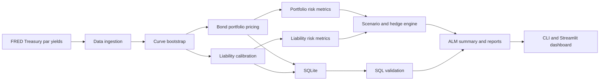

# ALM Risk Simulator

**Interest-rate risk modelling and hedging for a simplified life insurer, built with Python, numerical methods, SQL, and Streamlit.**

**[Live Dashboard](https://alm-risk-simulator.streamlit.app/)**


> **Educational model, not a production ALM engine.** The Treasury par-yield curve is sourced from FRED. The bond portfolio, credit spreads, and insurance liabilities are hypothetical.

## Overview

Life insurers invest premiums in bonds while promising payments that may extend decades into the future. When interest rates change, the present values of assets and liabilities move by different amounts. If liabilities are more rate-sensitive than assets, the resulting mismatch can threaten the insurer's funding position.

This project models that problem end to end:

- Builds a zero-coupon discount curve from U.S. Treasury par yields.
- Prices a hypothetical bond portfolio and long-dated liability cash flows.
- Measures duration, convexity, DV01, and key-rate DV01.
- Reprices the balance sheet under parallel shifts, curve twists, and long-end shocks.
- Solves for a key-rate hedge and quantifies residual risk.
- Uses SQLite validation checks and automated tests to verify data and calculations.

## Headline Results

The hypothetical insurer starts with a **107.5% funding ratio**, meaning modeled assets exceed modeled liabilities by 7.5%. However, asset duration is approximately **6.1 years**, compared with **11.3 years** for liabilities, creating a significant interest-rate mismatch.

Results use the FRED Treasury curve snapshot dated **October 15, 2026**.

| Metric | Unhedged | With key-rate hedge |
|---|---:|---:|
| Funding ratio, −200 bp parallel shock | **95.9%** | 105.7% |
| Funding ratio, +200 bp parallel shock | 118.5% | 109.1% |
| Worst surplus swing across 9 scenarios | **$117.7M** | **$2.1M** |
| Net DV01 | −$445,399/bp | Approximately $0/bp |
| Break-even shock to 100% funding | Approximately −131 bp | N/A |

The hedge reduces the worst surplus swing across the tested scenarios by approximately **98%**. Without hedging, a −200 bp shock pushes the funding ratio below 100%.


The overlay neutralizes net key-rate DV01 at the model's 2-, 5-, 10-, 20-, and 30-year tenors. It does not eliminate convexity or risk between key tenors, leaving a residual surplus swing of approximately $2.1M across the tested scenarios.

Reproduce the results with `python -m src.pipeline`. Figures depend on the curve snapshot and model assumptions.

## How the Model Works

### 1. Yield Curve Construction

- Retrieves U.S. Treasury constant-maturity par yields from FRED.
- Approximates the short end using money-market or zero-coupon conventions.
- Bootstraps longer tenors into zero rates so par bonds reprice consistently with the input yields.
- Uses linear interpolation on zero rates and flat extrapolation beyond the final curve pillar.

### 2. Asset and Liability Valuation

**Bond portfolio**

Each hypothetical bond is valued by discounting its cash flows using the Treasury zero curve plus an assumed credit spread. Yield to maturity is solved as the flat yield that reproduces the curve-based price under simplified cash-flow conventions.

**Insurance liabilities**

The synthetic liability schedule combines three components:

- An annuity-style payout stream.
- A death-benefit hump.
- A long-dated tail factor.

Liabilities are discounted using the Treasury curve plus a configurable liability spread. The cash-flow schedule is scaled once to achieve the target baseline funding ratio.

Liability cash flows remain frozen under subsequent rate shocks. Recalibrating them after each shock would artificially suppress the measured interest-rate risk.

### 3. Risk Measurement and Scenarios

The engine calculates present values, surplus, funding ratio, duration, convexity, and DV01. Effective duration and convexity are estimated using bump-and-reprice calculations, while key-rate measures identify sensitivity at individual curve tenors.

The scenario engine evaluates:

- Parallel shifts of ±50, ±100, and ±200 basis points.
- A steepener and flattener pivoting at 10 years.
- A long-end rally affecting maturities of 20 years and beyond.

Each scenario uses full repricing. For parallel shocks, the pipeline also compares the results against a second-order Taylor estimate using dollar duration and convexity.

### 4. Key-Rate Hedging

The hedge solver calculates zero-coupon Treasury positions at the 2-, 5-, 10-, 20-, and 30-year key tenors to neutralize net key-rate DV01.

The overlay has approximately zero initial net value under the model's financing convention, leaving the baseline funding ratio unchanged. However, it does not eliminate convexity, inter-tenor risk, or practical implementation costs.

### 5. Model-Risk Sensitivities

The model tests how valuation and risk change under alternative assumptions.

- **Liability discount spread:** Varying the spread from 0 to 100 bp changes liability duration from approximately 11.5 to 10.7 years and net DV01 from approximately −$464K to −$393K per bp.
- **Curve interpolation:** Using log-linear discount-factor interpolation instead of linear zero-rate interpolation changes liability present value by approximately −$2.5M relative to the baseline method.

These checks illustrate how modelling choices affect valuation and hedge sizing.

## Architecture and Data Flow



The code is organized by responsibility:

| Module | Responsibility |
|---|---|
| `src/config.py` | Model configuration and numerical conventions |
| `src/data_fetch.py` | FRED retrieval and offline fallback |
| `src/curve.py` | Curve bootstrapping, interpolation, and shocks |
| `src/bonds.py` | Bond pricing and portfolio aggregation |
| `src/liabilities.py` | Liability cash flows and calibration |
| `src/duration.py` | Duration, convexity, DV01, and ALM formulas |
| `src/db.py` | SQLite persistence and aggregation queries |
| `src/validation.py` | SQL-based data-quality checks |
| `src/scenarios.py` | Scenario repricing, hedge solver, and sensitivities |
| `src/pipeline.py` | End-to-end analysis |
| `src/report.py` | Chart generation |
| `app.py` | Interactive Streamlit dashboard |

## Technology Stack

- **Python 3.11+** — core modelling and orchestration
- **NumPy and pandas** — numerical and tabular data processing
- **SciPy** — root-finding and interpolation
- **SQLite** — data persistence, aggregation, and validation
- **Requests** — FRED data retrieval
- **Matplotlib and Streamlit** — visualizations and interactive dashboard
- **pytest and GitHub Actions** — automated testing and CI

## Setup and Usage

### 1. Clone the repository and install dependencies

```bash
git clone https://github.com/Manal9667/ALM-Risk-Simulator.git
cd ALM-Risk-Simulator

python -m venv .venv

# Windows
.venv\Scripts\activate

# macOS/Linux
source .venv/bin/activate

pip install -r requirements.txt
```

### 2. Fetch a Treasury curve snapshot

```bash
python -m src.data_fetch
```

The project uses retrieved or locally cached FRED data when available. If retrieval fails, it follows the configured offline fallback path using the fixture in `tests/fixtures/treasury_curve_fixture.csv`. Fixture data is identified as synthetic rather than presented as live market data.

### 3. Run the analysis pipeline

```bash
python -m src.pipeline
```

This constructs the curve, generates the hypothetical asset portfolio, values the liability schedule, validates the data, and reports the ALM summary, key-rate risk, scenario results, hedge, and sensitivities.

### 4. Launch the dashboard

```bash
streamlit run app.py
```

The dashboard provides interactive parallel shocks, steepening and flattening controls, a hedge toggle, funding-ratio charts, key-rate DV01 profiles, scenario tables, model-risk sensitivities, and holdings.

### 5. Regenerate charts and run tests

```bash
python -m src.report
pytest -q
```

## Testing and Reliability

The repository includes **50 automated tests**, with CI configured to run the suite on every push.

Tests cover:

- Curve bootstrapping and input validation.
- Bond pricing, portfolio aggregation, and risk formulas.
- Liability calibration and duration consistency.
- SQL validation and aggregation queries.
- Scenario repricing and key-rate hedge effectiveness.
- Taylor approximations against full repricing.
- Dashboard behavior using Streamlit `AppTest`.

The pipeline is deterministic for a given dataset and configuration. Market-dependent results may change as the Treasury curve snapshot changes.

## Assumptions and Limitations

This is a simplified educational model, not a production ALM engine.

- **Hypothetical balance sheet:** The assets, credit spreads, and liability cash flows are synthetic. The 107.5% baseline funding ratio is a calibration input, not a model-discovered result.
- **Simplified curve:** Linear interpolation on zero rates is not an arbitrage-free curve construction framework.
- **Simplified bond conventions:** Trade-date settlement, accrual, and day-count conventions are idealized.
- **Simplified insurance liabilities:** The model excludes stochastic mortality, policy lapses, withdrawals, and policyholder optionality.
- **Idealized hedge:** The overlay excludes bid-ask spreads, transaction costs, margin, collateral, liquidity constraints, and basis risk. Its zero initial net value is a modelling convention, not a claim that real hedging is costless.
- **No regulatory capital framework:** Solvency II, risk-based capital, and other regulatory requirements are outside scope.

Future extensions could include arbitrage-free curve construction, policyholder behaviour models, realistic hedge instruments, and constrained hedge optimization incorporating implementation costs.

## Repository Structure

```text
.
├── .github/workflows/ci.yml
├── data/
├── docs/
├── sql/
│   ├── aggregations.sql
│   ├── schema.sql
│   └── validation_checks.sql
├── src/
│   ├── bonds.py
│   ├── config.py
│   ├── curve.py
│   ├── data_fetch.py
│   ├── db.py
│   ├── duration.py
│   ├── liabilities.py
│   ├── pipeline.py
│   ├── report.py
│   ├── scenarios.py
│   └── validation.py
├── tests/
│   ├── fixtures/
│   ├── test_app.py
│   ├── test_bonds.py
│   ├── test_curve.py
│   ├── test_duration.py
│   ├── test_liabilities.py
│   ├── test_scenarios.py
│   └── test_validation.py
├── app.py
├── requirements.txt
└── README.md
```
