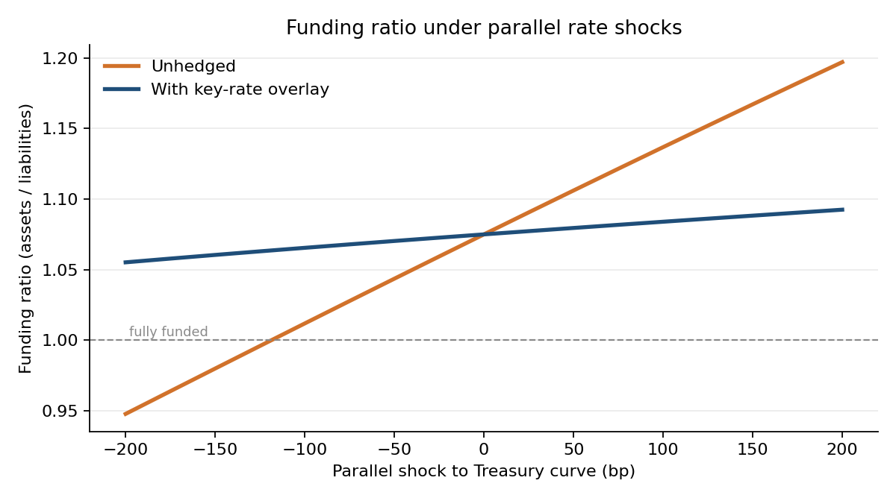
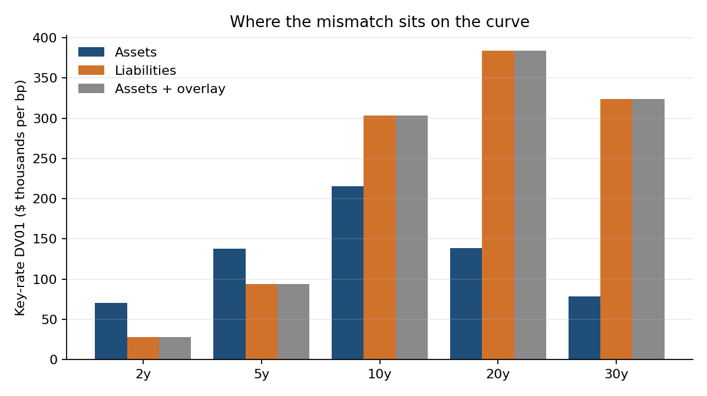
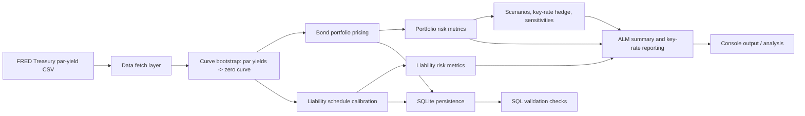

# ALM Risk Simulator


Interest-rate risk for a simplified life insurer: price a bond book and a long-dated liability stream on a bootstrapped Treasury curve, measure the mismatch (duration, DV01, key-rate DV01), shock the curve, and hedge it.

> **Educational model, not a production ALM engine.** Only the Treasury par-yield curve is real (FRED). The bond portfolio, credit spreads and liability book are hypothetical and labelled as such.

**Live dashboard:** https://alm-risk-simulator.streamlit.app/

## Headline result

The hypothetical insurer starts 107.5% funded but is badly mismatched: assets have a duration of **6.1 years** against **11.3 years** for liabilities (net DV01 **-$445k per bp**). Falling rates hurt, because liabilities are the longer instrument. Results below use the FRED Treasury curve as of **15 Oct 2026**.



| | Unhedged | With key-rate overlay |
|---|---|---|
| Funding ratio, -200bp parallel | **95.9%** (underfunded) | 105.7% |
| Funding ratio, +200bp parallel | 118.5% | 109.1% |
| Worst surplus swing across 9 scenarios | **$117.7M** | **$2.1M** (-98%) |
| Net DV01 | -$445,399 | $0 |
| Break-even shock to 100% funded | about -131bp | n/a |

The overlay is a zero-cost set of zero-coupon Treasury positions (short 2-5y, long 10-30y) sized so that net DV01 is zero at every key tenor, which is how insurers hedge in practice with swaps and futures.



What the overlay does **not** fix is convexity and risk between key tenors. That is the ~$2M residual in the -200bp case, and the scenario table reports it rather than hiding it. Reproduce every number with `python -m src.pipeline` (figures move with the curve date; the committed snapshot is 2026-10-15).

## Problem being solved

- What is the present value of assets and liabilities on the current Treasury curve?
- How sensitive is each side to rate moves, and where on the curve does the mismatch sit?
- What happens to the funding ratio under parallel, steepening, flattening and long-end shocks?
- How much of the risk can a key-rate overlay remove, and what is left over?
- How much do the answers depend on modelling assumptions (liability discount spread, curve interpolation)?

## Who this is for

- Students and interns learning ALM and duration analysis
- Quantitative developers reviewing simplified risk models
- Recruiters and hiring managers evaluating engineering judgment and model transparency

## Architecture and data flow



The code is structured by concern:

- `src/config.py`: project-wide configuration and numerical conventions
- `src/data_fetch.py`: real FRED fetch and offline fallback behavior
- `src/curve.py`: zero curve construction, interpolation, and shocks
- `src/bonds.py`: hypothetical bond holdings and portfolio risk aggregation
- `src/liabilities.py`: liability cash-flow schedule and calibration
- `src/duration.py`: duration, convexity, DV01, and ALM formulas
- `src/db.py`: SQLite loading and aggregation queries
- `src/validation.py`: SQL-based data-quality checks
- `src/scenarios.py`: rate-shock scenarios, key-rate hedge solver, spread and interpolation sensitivities
- `src/pipeline.py`: end-to-end base-case run
- `src/report.py`: regenerates the charts in `docs/`
- `app.py`: Streamlit dashboard over the same engine

## Technology stack

- Python 3.11+
- NumPy and Pandas for numerical data work
- SciPy for root-finding and interpolation
- SQLite for validation and aggregation tables
- Requests for the FRED data fetch
- Matplotlib and Streamlit for charts and the dashboard
- Pytest for verification

## Setup

```bash
python -m venv .venv
# Windows
.venv\Scripts\activate
# macOS/Linux
source .venv/bin/activate

pip install -r requirements.txt
```

## Run the application

### 1) Fetch a real curve snapshot from FRED

```bash
python -m src.data_fetch
```

If FRED is unavailable, the project falls back to the clearly labelled fixture in `tests/fixtures/treasury_curve_fixture.csv` and emits a non-fabricated offline path without claiming real market data.

### 2) Run the base case

```bash
python -m src.pipeline
```

This builds the term structure, generates a deterministic hypothetical asset book, prices the liability schedule, validates the data, and prints the ALM summary, key-rate profile, shock scenarios, hedge and sensitivities.

### 3) Run the polished dashboard UI

```bash
streamlit run app.py
```

Sidebar controls set a parallel shift and a steepen/flatten twist and toggle the hedge overlay. Tabs show funding ratio vs shock, key-rate DV01s, the full scenario table, model-risk sensitivities, and holdings. To deploy free on Streamlit Community Cloud, point it at `app.py` and commit a real FRED snapshot from step 1 so the hosted app does not fall back to the synthetic fixture.

### 4) Regenerate charts

```bash
python -m src.report
```

### 5) Run tests

```bash
pytest -q
```

## Configuration and environment

The project intentionally keeps all model assumptions in `src/config.py` rather than hard-coding values in business logic.

Key settings include:

- Treasury curve bootstrap frequency and zero-curve conventions
- Short-end cutoff for money-market vs par-bond treatment
- Bond credit spread assumptions by rating category
- Liability shape parameters and funding-ratio calibration target
- Risk measurement bump sizes and tolerance settings

No secrets or credentials are required for the default setup. The project does not use API keys for FRED and does not store any sensitive data in source control.

## Calculation methodology and assumptions

### Curve construction

- Real observations are taken from FRED constant-maturity Treasury par yields.
- The short end is treated as a money-market/zero-coupon approximation.
- Longer tenors are bootstrapped into zero rates so that par bonds repriced on the zero curve are consistent with their input par yields.
- Interpolation is linear on zero rates with flat extrapolation beyond the last pillar.

### Bond pricing

- Each bond is valued by discounting its cash flows on the Treasury zero curve plus a hypothetical credit spread.
- Settlement is treated on a simplified idealized schedule; no real trade-date conventions are modeled.
- Yield to maturity is solved as the flat yield that reproduces the curve price for the same cash-flow schedule.

### Liability modeling

- The liability stream is synthetic and uses three components:
  - an annuity-style payout stream,
  - a death-benefit hump,
  - a long-dated tail factor.
- Liabilities are discounted on the Treasury curve plus a liability spread to reflect an illiquidity/own-credit adjustment.
- The raw schedule is scaled to a target funding ratio near the configured base case.

### Risk measures

- Duration and convexity are measured in standard market-style conventions.
- DV01 is based on a 1 bp parallel yield move.
- Effective duration and convexity are estimated by bump-and-reprice on the zero curve.
- Key-rate durations are decomposed across the configured curve tenors and sum back to the approximate parallel duration.

### Scenarios and hedging

- Liability cash flows are **frozen** at the base case and re-discounted on each shocked curve. Re-calibrating them to a target funding ratio on a shocked curve would pin the funding ratio and hide all rate risk, so it is done once, at the base case only (covered by a regression test).
- Scenarios: parallel +/-50, 100, 200bp; a steepener and flattener pivoting at 10y; and a 20y+ long-end rally. Each is a full revaluation. For parallel shocks the second-order Taylor estimate from the surplus's dollar duration and convexity is shown alongside, staying within ~3% of full repricing at +/-100bp.
- The hedge solves a linear system for zero-coupon Treasury positions at the 2/5/10/20/30y key tenors so every net key-rate DV01 is zero. The overlay is financed at a rate-insensitive funding rate, so it has zero day-one value and leaves the funding ratio unchanged.

### Model-risk checks

- **Liability discount spread (0 to 100bp):** liability duration moves from 11.5y to 10.7y and net DV01 from -$464k to -$393k. The hedge ratio is sensitive to this assumption.
- **Interpolation:** valuing the same pillars log-linearly on discount factors instead of linearly on zeros changes liability PV by about -27bp (-$2.5M), small next to the rate risk but not zero.

### Sign and unit conventions

- Price, market value, and present value are in currency units.
- Duration is measured in years.
- DV01 represents the change in value for a 1 bp move, with positive sign convention for long positions when value rises as yields fall.
- Funding ratio is assets divided by liabilities, so a ratio above 1.0 indicates surplus.

## Example scenario interpretation

A typical base-case run prints:

- asset market value
- liability present value
- surplus and funding ratio
- duration gap and leverage-adjusted gap
- asset and liability DV01
- key-rate duration profile

For example, if the funding ratio is 1.075, the balance sheet is 7.5% funded above liabilities. If the duration gap is negative, liabilities are more rate-sensitive than assets, so a fall in rates can improve the funding ratio while a rise in rates can worsen it.

## Data and reliability notes

- Real market data is only used when fetched from FRED or already cached locally.
- Offline fixture data is clearly marked as synthetic and not presented as live market data.
- Missing or malformed source data is surfaced explicitly instead of silently fabricating values.
- The project relies on deterministic calculations given the same input data.
- All SQL validation checks are structured so invalid inputs fail loudly when they violate the expected schema or range conditions.

## Testing and verification

The repository includes automated checks for:

- curve bootstrap validity
- pricing and duration formulas
- bond portfolio aggregation
- liability schedule calibration and duration consistency
- SQL validation rules and aggregation queries
- scenario engine: liabilities re-discount under shocks, hedge zeroes key-rate DV01s at zero cost, hedge cuts every scenario's surplus swing by over 95%, Taylor vs full reprice
- dashboard smoke tests (Streamlit `AppTest`): shocks move the funding ratio and the hedge toggle flattens it

CI runs the full suite (50 tests) on every push.

Run:

```bash
pytest -q
python -m src.pipeline
```

## Known limitations

This is a simplified educational model. It does not attempt to represent:

- full trade-date accrual and day-count conventions
- real insurer policy cash-flow behaviour (lapses, mortality, optionality), so there is no stochastic or option-adjusted treatment
- liquidity-adjusted valuation frameworks or regulatory capital (Solvency II, RBC)
- an arbitrage-free curve (linear-on-zeros interpolation; the effect is quantified above)
- realistic hedge frictions: the overlay uses idealised zero-coupon exposures with no bid-ask, margin or basis risk, and the gross notional (~$599M, about 60% of assets) is large
- the starting 107.5% funding ratio, which is a calibration input, not a result

In production the next steps would be an arbitrage-free curve, policyholder behaviour models and a constrained optimiser over real hedge instruments.

## Repository layout

```text
.
├── README.md
├── app.py
├── .github/workflows/ci.yml
├── docs/                      # charts used in this README
├── requirements.txt
├── pytest.ini
├── data/
│   ├── README.md
├── app.py
├── .github/workflows/ci.yml
├── docs/                      # charts used in this README
│   ├── holdings_corrupted_sample.csv
│   ├── holdings_hypothetical.csv
│   ├── liabilities_hypothetical.csv
│   └── treasury_curve_*.csv (when fetched)
├── sql/
│   ├── aggregations.sql
│   ├── schema.sql
│   └── validation_checks.sql
├── src/
│   ├── __init__.py
│   ├── bonds.py
│   ├── config.py
│   ├── curve.py
│   ├── data_fetch.py
│   ├── db.py
│   ├── duration.py
│   ├── liabilities.py
│   ├── pipeline.py
│   ├── report.py
│   ├── scenarios.py
│   └── validation.py
├── tests/
│   ├── conftest.py
│   ├── fixtures/
│   ├── test_bonds.py
│   ├── test_curve.py
│   ├── test_duration.py
│   ├── test_app.py
│   ├── test_liabilities.py
│   ├── test_scenarios.py
│   └── test_validation.py
└── .venv/ (local environment, not tracked)
```
